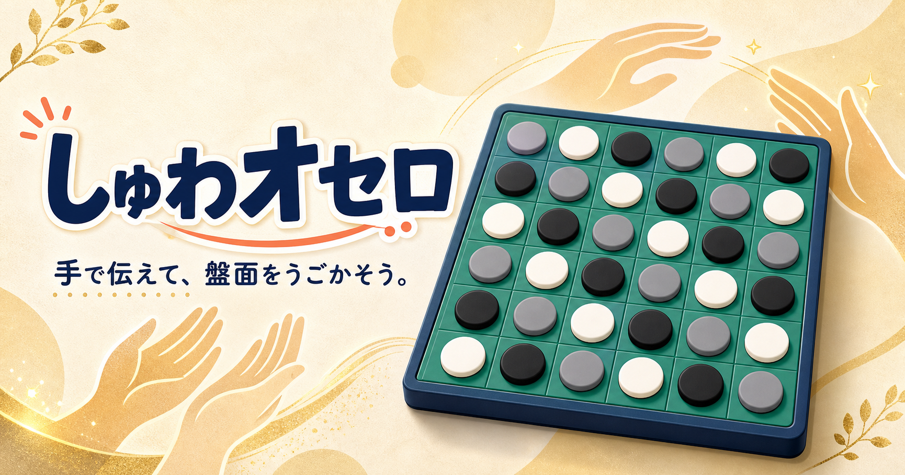

# しゅわオセロ

手話で単語を表現しながら遊ぶ、6×6の対戦オセロです。

**プレイ:** https://souma1030.github.io/shuwa-othello/



## 遊び方

1. 黄色く光っているコマから、表現する単語を選びます。
2. プレイヤーがその単語を手話で表現します。
3. 正解ならコマをクリック。不正解なら「ターンをパス」を押します。

基本的なオセロの合法手判定、コマの反転、得点集計、勝敗判定に対応しています。

## ローカルで起動

```bash
npm install
npm run dev
```

`main` ブランチへ反映すると、GitHub Actions が自動的に GitHub Pages 用のサイトを公開します。
